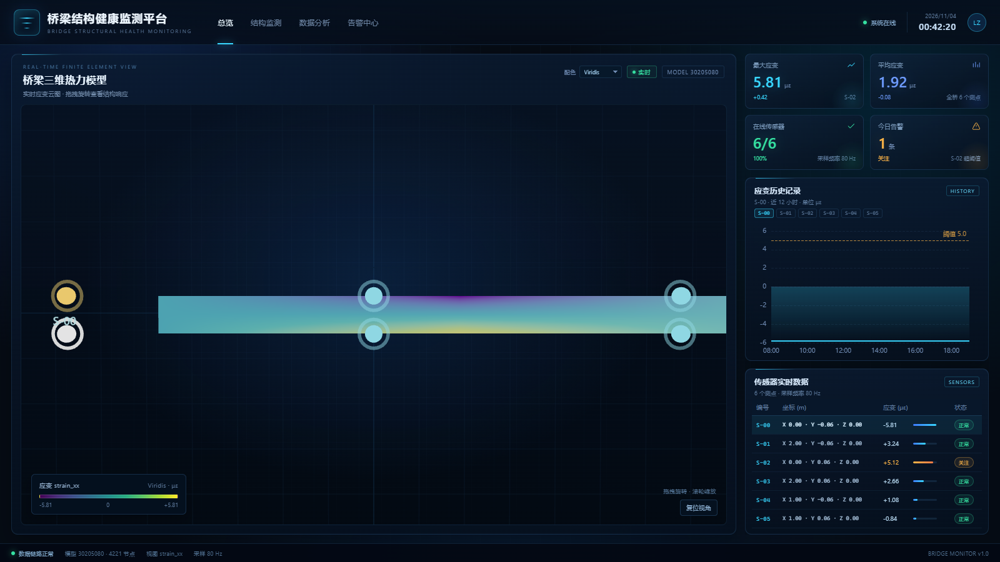

# 验收说明

> 临时验收文档，不是正式产品文档。  
> 分支：`react-dashboard`  
> 日期：2026-11-04



## 这一版包含什么

- 顶部：平台标题、导航占位、系统状态、实时时钟、用户头像
- 中间：Three.js 桥梁热力模型，支持拖拽自由旋转、滚轮缩放
- 传感器：按原版布局放在桥面 **4 个角 + 两条长边中点**，共 6 个
- 选中传感器：只改变颜色（白色高亮），不改变大小
- 配色：右上角下拉，使用原版 `colorMap.json` 的 11 套色板
- 右侧：6 个传感器芯片、ECharts 应变历史、传感器实时数据表
- 表格：编号 / 坐标 / 应变 / 状态，不显示温度
- 采样频率：80 Hz
- 点击传感器标记、芯片或表格行，会切换右边的应变历史

## 怎么操作

1. 拖拽中间桥面：自由旋转，没有俯仰角限制
2. 滚轮：缩放
3. 右上角“配色”：切换热力色板
4. 点击 `S-00` ~ `S-05` 芯片或表格行：切换传感器
5. 右下角“复位视角”：回到正面平视

## 运行

```bash
npm install
npm run dev
```

## 说明

- 这是 React 验收版，演示数据为本地 mock，没有接后端 / SSE。
- 没有真实历史数据时，应变历史用当前值画水平线，不伪造波动。
- `public/model.glb` 已包含；真实热力 bin 数据可选，没有时回退为位置渐变。
- 这个文档只用于当前阶段验收，后续正式文档会单独整理。
