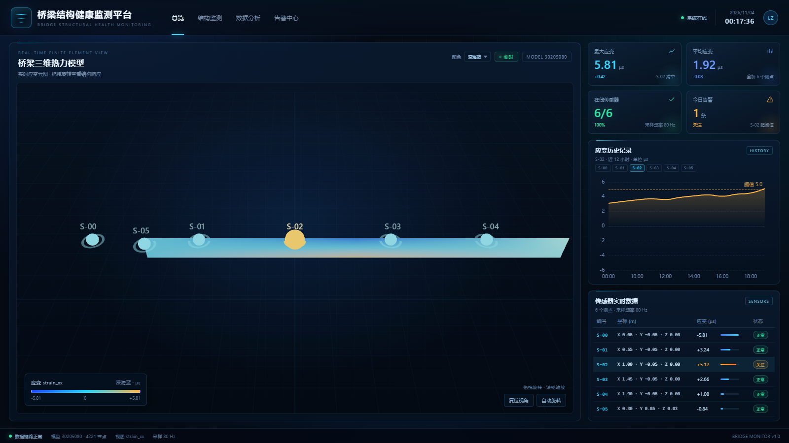

# bridge-visualization · React Dashboard

**Languages:** [English](#english) · [中文](#中文)

---

## English

A React dashboard for bridge structural health monitoring: a Three.js bridge heatmap in the center, an ECharts strain-history chart and a sensor table on the right, and a product-style header/status bar.



### Features

- Six sensor markers drawn on the 3D bridge; click a marker, chip or table row to view that sensor's history
- Switchable heatmap palettes: Ocean, Viridis, Turbo, Coolwarm
- 80 Hz sampling label, sensor ID / coordinates / strain / status table (no temperature field)
- Flat default camera; reset view and optional auto-rotation

### Stack

- React 19 + Vite 8
- Three.js (GLTFLoader + OrbitControls) for the 3D bridge
- ECharts 6 for the trend chart
- Plain CSS layout, no UI framework

### Run

```bash
npm install
npm run dev
```

Open the printed local URL.

### Structure

```text
index.html
src/
  App.jsx                  dashboard layout
  App.css                  dashboard styles
  components/
    Header.jsx             product header + live clock
    BridgeViewport.jsx     Three.js bridge + heatmap colors
    KpiGrid.jsx            KPI cards
    MonitorChart.jsx       ECharts strain history
    SensorTable.jsx        sensor table
  data/mock.js             demo KPI / history / sensor data
  data/palettes.js         heatmap palettes and interpolation
public/
  model.glb                bridge geometry
docs/dashboard.png         preview image
```

### Model and data

`public/model.glb` is included. The viewport first tries to load `public/bridge_output/30205080.1784464473837.0.bin` plus its JSON metadata for real strain colors; if those files are absent it falls back to a position-based heat gradient. The demo data is not committed.

### Related

- `main` branch: original vanilla Three.js viewer.
- [DISCLAIMER.md](DISCLAIMER.md) · [LICENSE](LICENSE)

---

## 中文

基于 React 的桥梁结构健康监测大屏：中间是 Three.js 桥梁热力模型，右侧是 ECharts 应变历史记录和传感器表格，顶部是产品化的标题栏与状态栏。


### 功能

- 三维桥梁上绘制 6 个传感器标记；点击标记、顶部芯片或表格行，查看该传感器的应变历史
- 热力配色可切换：深海蓝、Viridis、Turbo、冷暖
- 采样频率 80 Hz；表格显示编号 / 坐标 / 应变 / 状态（不显示温度）
- 默认视角压平；支持复位视角和自动旋转

### 技术栈

- React 19 + Vite 8
- Three.js（GLTFLoader + OrbitControls）负责三维桥梁
- ECharts 6 负责趋势图
- 纯 CSS 布局，没有引入 UI 框架

### 运行

```bash
npm install
npm run dev
```

打开终端输出的本地地址。

### 结构

```text
index.html
src/
  App.jsx                  大屏布局
  App.css                  大屏样式
  components/
    Header.jsx             顶部标题栏 + 实时时钟
    BridgeViewport.jsx     Three.js 桥梁 + 热力颜色
    KpiGrid.jsx            KPI 指标卡
    MonitorChart.jsx       ECharts 应变历史
    SensorTable.jsx        传感器表格
  data/mock.js             演示 KPI / 历史 / 传感器数据
  data/palettes.js         热力配色与插值
public/
  model.glb                桥梁几何
docs/dashboard.png         预览图
```

### 模型与数据

`public/model.glb` 已包含。三维视图会优先读取 `public/bridge_output/30205080.1784464473837.0.bin` 和对应 JSON 元数据来显示真实应变颜色；如果文件不存在，则回退为基于位置的渐变色。演示数据不提交。

### 相关

- `main` 分支：原来的原生 Three.js 查看器。
- [DISCLAIMER.md](DISCLAIMER.md) · [LICENSE](LICENSE)
